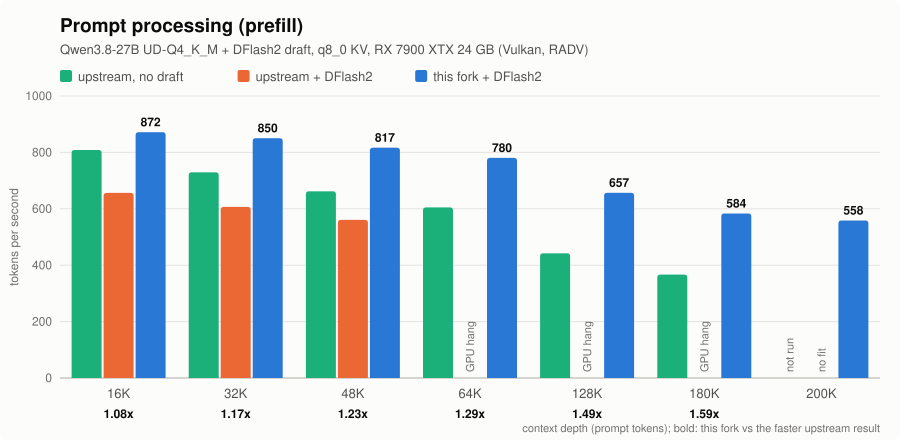
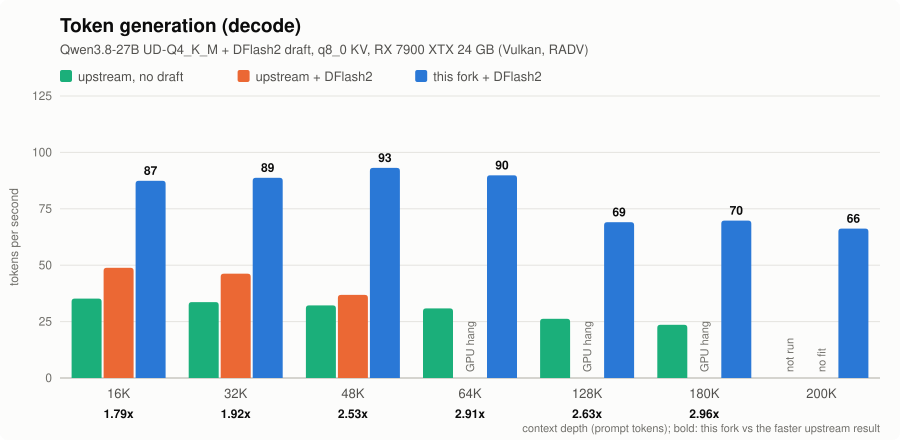

# llama.cpp for AMD RDNA3 (RX 7900 XTX)

A fork of [ggml-org/llama.cpp](https://github.com/ggml-org/llama.cpp) tuned for **AMD Radeon RX 7000 (RDNA3) GPUs on the
Vulkan backend**. It focuses on long-context use, such as agentic coding with 100K-200K tokens of context, with the
Qwen3.5 / Qwen3.8 hybrid models and speculative decoding (DFlash2 or MTP drafts).

It is the same llama.cpp: the same model files, the same `llama-server`, the same API and web UI. The difference is in
the Vulkan kernels, the graph and the speculative-decoding loop. All optimizations are on by default. The only new
flags are two optional speculative-decoding settings (`--spec-accept rejection`, `--spec-draft-vocab`).

**What you get on one RX 7900 XTX with Qwen3.8-27B UD-Q4_K_M + a DFlash2 draft:**

- **Up to 220K tokens of context** on a 24 GB card. Upstream fits about 192K with the same model and draft.
- **DFlash2 speculative decoding that works at long context.** On upstream llama.cpp (both the commit this fork branches
  from and current master), DFlash2 hangs the GPU once the prompt passes about 60K tokens.
- **Decode 1.8-3.0x faster and prefill 1.1-1.6x faster** than the faster of the two upstream setups at the same depth: 87 vs 49 tokens/s decode and 872 vs 808 tokens/s prefill at 16K, 69 vs 26 tokens/s decode and 657 vs 442 tokens/s prefill at 128K.

## Benchmarks

Qwen3.8-27B UD-Q4_K_M target + Qwen3.8-27B DFlash2 Q4_K_M draft, q8_0 KV cache, `-b 512 -ub 512`, flash attention,
thinking on, temperature 1.0. One RX 7900 XTX (24 GB) at the stock 291 W limit, Mesa RADV. Context size: this fork
`-c 220000`, upstream `-c 196608` (the largest each fits). Upstream is master at `f174553e1` (2026-10-19). Full method,
commands and raw results: [docs/rdna3/BENCHMARKS.md](docs/rdna3/BENCHMARKS.md).





| Prefill, tokens/s | 16K | 32K | 48K | 64K | 128K | 180K | 200K |
|---|---:|---:|---:|---:|---:|---:|---:|
| upstream, no draft | 808.4 | 729.4 | 662.1 | 605.0 | 442.1 | 366.7 | not run |
| upstream + DFlash2 | 656.5 | 606.7 | 560.7 | GPU hang | GPU hang | GPU hang | no fit |
| this fork + DFlash2 | **871.8** | **850.3** | **816.7** | **780.5** | **656.6** | **583.5** | **558.5** |

| Decode, tokens/s | 16K | 32K | 48K | 64K | 128K | 180K | 200K |
|---|---:|---:|---:|---:|---:|---:|---:|
| upstream, no draft | 35.2 | 33.7 | 32.2 | 30.8 | 26.3 | 23.6 | not run |
| upstream + DFlash2 | 48.8 | 46.2 | 36.8 | GPU hang | GPU hang | GPU hang | no fit |
| this fork + DFlash2 | **87.4** | **88.8** | **93.2** | **89.8** | **69.1** | **69.8** | **66.2** |

"GPU hang": upstream's DFlash2 path stops with `vk::Queue::submit: ErrorDeviceLost` (a compute queue timeout) when the
prompt reaches about 60K tokens. This happened at the same token position on every run, on both upstream builds we
tested, and does not happen on this fork or on upstream without a draft.

Decode speed with a draft depends on how many drafted tokens are accepted, which depends on the text. Expect a few
percent of variation between prompts.

## Quick start

### Build

You need the Vulkan SDK (or your distribution's Vulkan headers, `glslc` and `spirv-headers`) and a Mesa RADV driver
that exposes `VK_KHR_cooperative_matrix` (check with `vulkaninfo | grep cooperative_matrix`). The fork was developed
on Mesa 26.0. See [docs/build.md](docs/build.md#vulkan) for the Vulkan build in general.

```bash
git clone https://github.com/vansh-visariya/rx7900-xtx.git llama.cpp-rdna3
cd llama.cpp-rdna3
git checkout spec-90
cmake -B build -DGGML_VULKAN=ON -DCMAKE_BUILD_TYPE=Release
cmake --build build --config Release -j --target llama-server
```

Check that your GPU is listed and note its name (`Vulkan0` on most desktops; on laptops with an integrated GPU it may be
`Vulkan1`):

```bash
build/bin/llama-server --list-devices
```

### Run (Qwen3.8-27B + DFlash2, long context)

```bash
build/bin/llama-server \
  -m Qwen3.8-27B-UD-Q4_K_M.gguf -lm dio \
  --device Vulkan0 -ngl 999 -fa on -c 220000 \
  --cache-type-k q8_0 --cache-type-v q8_0 --cache-ram 1024 --ctx-checkpoints 3 \
  -b 512 -ub 512 \
  --spec-type draft-dflash -md Qwen3.8-27B-DFlash2-Q4_K_M.gguf \
  --spec-draft-device Vulkan0 --spec-draft-ngl 999 --spec-draft-n-max 4 \
  --spec-accept rejection -bs --spec-draft-vocab 65536 \
  --parallel 1 --host 127.0.0.1 --port 8080 \
  --temp 1.0 --top-p 0.95 --top-k 20 --min-p 0.0 --presence-penalty 0.0 --repeat-penalty 1.0
```

What the flags do:

| Flag | Why |
|---|---|
| `-b 512 -ub 512` | prompt batches of 512 tokens use the large matmul tile and the prompt-batch attention kernel |
| `--cache-type-k q8_0 --cache-type-v q8_0` | 8-bit KV cache: 34 KB per token for this model, so 220K tokens take 7.7 GB |
| `--spec-draft-n-max 4` | 4 drafted tokens per cycle (5 was slower in every test) |
| `--spec-accept rejection` | lossless rejection-sampling verification: same output distribution, more tokens accepted at temperature 1 |
| `-bs` | sampling runs on the GPU, so the 248K-entry vocabulary does not go through the CPU |
| `--spec-draft-vocab 65536` | the draft scores only the first 64K token ids (no change in acceptance) |
| `-lm dio` | loads the model with direct IO, so it does not go through the page cache (important if you have less RAM than the model) |
| `--ctx-checkpoints 3` | keep 3 recurrent-state checkpoints per slot in RAM (each is ~150 MB for this model) |

Other setups:

- **IQ3_S model (12 GB):** `Qwen3.8-27B` IQ3_S with the same command fits `-c 250072` and adds the vision projector
  (`--mmproj mmproj-Qwen3.8-27B-BF16.gguf --mmproj-device Vulkan0`). Measured on this fork: prefill 814 / 760 / 641 t/s and
  decode 106 / 93 / 85 t/s at 16K / 64K / 128K.
- **MTP draft instead of DFlash2:** replace the `--spec-type ...` block with `--spec-type draft-mtp --spec-draft-n-max 3`
  (for a model with MTP layers), keep `--spec-accept rejection -bs --spec-draft-vocab 65536`.
- **Free VRAM left:** `-ot token_embd.weight=Vulkan0` moves the token embedding table to the GPU (+379 MB for this
  model, identical output, a little faster).
- **Web UI:** tick Settings -> Sampling -> "Backend sampling". The web UI sends `backend_sampling: false` by default,
  which turns `-bs` off for its requests (about 10% slower decode). API clients that do not send the field use the
  server setting.

### Other RDNA3 cards

Everything was developed and measured on an RX 7900 XTX (gfx1100). The other RDNA3 cards (RX 7900 XT / GRE, 7800 XT,
7700 XT, 7600) use the same instruction set and the same matrix (WMMA) instructions, so the kernels should run and
help there too, but they have not been tested. Smaller cards need a smaller model or context. Please open an issue with
your numbers, good or bad.

Before trusting a build on a new card, run the kernel tests (no model needed):

```bash
cmake --build build -j --target test-backend-ops
build/bin/test-backend-ops -o FLASH_ATTN_EXT -b Vulkan0
build/bin/test-backend-ops -o MUL_MAT -b Vulkan0
```

## What is changed

The fork adds 56 commits on top of upstream `f95b0d953` (2026-09-22), mostly in `ggml/src/ggml-vulkan/`, plus the
speculative-decoding loop (`common/speculative.cpp`, `tools/server/`) and the Qwen3.5 / 3.8 graph (`src/models/`). In
short:

- **Decode:** integer-dot mat-vecs for the IQ2 / IQ3 / K-quant types, a grouped-query flash attention kernel for verify
  batches, graph fusions (residual adds, norms, activations folded into neighbouring kernels), the gated delta net
  reading and writing its state in place and rolling back by replay instead of state snapshots (less VRAM), Vulkan
  command buffers recorded once and replayed for repeated graphs, the KQ mask built on the GPU, the DFlash2 draft kept
  on the GPU.
- **Prefill:** a 128x256 matmul tile for wide batches, f32 accumulators and double-buffered tiles in the quantized
  matmuls, a new flash attention kernel for prompt batches.
- **Speculative decoding:** lossless rejection-sampling verification, a reduced-vocabulary draft head, backend sampling
  that keeps working with the reasoning budget and tool-call grammars.

Each change, with the environment variable that switches it off: [docs/rdna3/OPTIMIZATIONS.md](docs/rdna3/OPTIMIZATIONS.md).

## Status and limits

- Tested with Qwen3.8-27B (UD-Q4_K_M, IQ3_S) and Qwen3.5-4B. Other models run like on upstream; the
  model-specific work (gated delta net, DFlash2) only applies to the Qwen3.5 / 3.8 family.
- The Vulkan kernels are tuned for RDNA3 with RADV. Other GPUs fall back to upstream code paths in most places, but this
  fork is only tested on RDNA3.
- The fork is not synced with upstream every day. It branches from `f95b0d953`.
- Not affiliated with ggml-org. Bugs in this fork belong in this repository's issues, not upstream's.

## License

MIT, like upstream: see [LICENSE](LICENSE). All credit for llama.cpp and ggml goes to Georgi Gerganov and the llama.cpp
contributors.

---

<details>
<summary><b>Upstream llama.cpp README</b></summary>


# llama.cpp


<div align="center">

<b>LLM inference in C/C++</b>

[](https://opensource.org/licenses/MIT)
[](https://github.com/ggml-org/llama.cpp/releases?q=tag:v0)
[](https://github.com/ggml-org/llama.cpp/releases?q=b)
[](https://github.com/ggml-org/llama.cpp/actions/workflows/server.yml)
[](https://github.com/ggml-org/llama.cpp/actions/workflows/docker.yml)
[](https://github.com/ggml-org/llama.cpp/actions/workflows/winget.yml)

[ggml](https://github.com/ggml-org/ggml) / [ops](https://github.com/ggml-org/llama.cpp/blob/master/docs/ops.md) / [maintainer PRs](https://github.com/ggml-org/llama.cpp/issues?q=is%3Apr%20is%3Aopen%20draft%3AFalse%20(author%3Argerganov%20OR%20author%3AKitaitiMakoto%20OR%20author%3Adanbev%20OR%20author%3Aaldehir%20OR%20author%3Amax-krasnyansky%20OR%20author%3ACISC%20OR%20author%3Aggerganov%20OR%20author%3Aam17an%20OR%20author%3Ajhen0409%20OR%20author%3Abartowski1182%20OR%20author%3Anikwen%20OR%20author%3Ahipudding%20OR%20author%3Aravi9%20OR%20author%3AServeurpersoCom%20OR%20author%3Apwilkin%20OR%20author%3Areeselevine%20OR%20author%3Angxson%20OR%20author%3Ajeffbolznv%20OR%20author%3Amarty1885%20OR%20author%3A0cc4m%20OR%20author%3ATitaniumtown%20OR%20author%3Aangt%20OR%20author%3AIMbackK%20OR%20author%3Aarthw%20OR%20author%3AJohannesGaessler%20OR%20author%3AORippler%20OR%20author%3Aruixiang63%20OR%20author%3Axctan%20OR%20author%3Aallozaur%20OR%20author%3Ayomaytk%20OR%20author%3Aaendk%20OR%20author%3Awine99%20OR%20author%3Agaugarg-nv%20OR%20author%3Ataronaeo%20OR%20author%3Aforforever73%20OR%20author%3Alhez%20OR%20author%3Anetrunnereve%20OR%20author%3Afairydreaming)%20sort%3Aupdated-desc) / [dev stats](https://github.com/ggml-org/llama.cpp-dev) / [lib llama API](https://github.com/ggml-org/llama.cpp/issues/9289) / [llama-server REST API](https://github.com/ggml-org/llama.cpp/issues/9291)

</div>

## Quick start

A few options to get `llama.cpp` installed on your machine:

- Visit https://llama.app and follow the instructions
- Run with Docker - see our [Docker documentation](docs/docker.md)
- Download pre-built binaries from the [releases page](https://github.com/ggml-org/llama.cpp/releases)
- Build from source by cloning this repository - check out [our build guide](docs/build.md)

Once installed:

```sh
# Download and run a model directly from Hugging Face
llama cli -hf ggml-org/Qwen3.5-0.8B-GGUF

# Launch OpenAI-compatible API server
llama serve -hf ggml-org/Qwen3.5-0.8B-GGUF
```

<table align="center">
    <tr>
        <td align="center" width=50%>
            
            <i>VLM session with <b>llama cli</b></i>
        </td>
        <td align="center">
            
            <i>Built-in web UI against <b>llama serve</b></i>
        </td>
    </tr>
<table>

## Description

The main goal of `llama.cpp` is to enable LLM (and VLM) inference with minimal setup and state-of-the-art performance on
a wide range of hardware - locally and in the cloud.

- Plain C/C++ implementation without any dependencies
- Apple silicon is a first-class citizen - optimized via ARM NEON, Accelerate and Metal frameworks
- AVX, AVX2, AVX512 and AMX support for x86 architectures
- RVV, ZVFH, ZFH, ZICBOP and ZIHINTPAUSE support for RISC-V architectures
- 1.5-bit, 2-bit, 3-bit, 4-bit, 5-bit, 6-bit, and 8-bit integer quantization for faster inference and reduced memory use
- Custom CUDA kernels for running LLMs on NVIDIA GPUs (support for AMD GPUs via HIP and Moore Threads GPUs via MUSA)
- Vulkan and SYCL backend support
- CPU+GPU hybrid inference to partially accelerate models larger than the total VRAM capacity

The `llama.cpp` project is build on top of the [ggml](https://github.com/ggml-org/ggml) library.

## Supported backends

| Backend | Target devices |
| --- | --- |
| [BLAS](docs/build.md#blas-build) | All |
| [BLIS](docs/backend/BLIS.md) | All |
| [CANN](docs/build.md#cann) | Ascend NPU |
| [CUDA](docs/build.md#cuda) | Nvidia GPU |
| [HIP](docs/build.md#hip) | AMD GPU |
| [Hexagon](docs/backend/snapdragon/README.md) | Snapdragon |
| [IBM zDNN](docs/backend/zDNN.md) | IBM Z & LinuxONE |
| [MUSA](docs/build.md#musa) | Moore Threads GPU |
| [Metal](docs/build.md#metal-build) | Apple Silicon |
| [OpenCL](docs/backend/OPENCL.md) | Adreno GPU |
| [OpenVINO [In Progress]](docs/backend/OPENVINO.md) | Intel CPUs, GPUs, and NPUs |
| [RPC](https://github.com/ggml-org/llama.cpp/tree/master/tools/rpc) | All |
| [SYCL](docs/backend/SYCL.md) | Intel GPU |
| [VirtGPU](docs/backend/VirtGPU.md) | VirtGPU APIR |
| [Vulkan](docs/build.md#vulkan) | GPU |
| [WebGPU](docs/build.md#webgpu) | All |
| [ZenDNN](docs/build.md#zendnn) | AMD CPU |

## Documentation

#### Tools

- [cli](tools/cli/README.md)
- [completion](tools/completion/README.md)
- [server](tools/server/README.md)
- [GBNF grammars](grammars/README.md)

#### Development

- [How to build](docs/build.md)
- [Running on Docker](docs/docker.md)
- [Build on Android](docs/android.md)
- [Multi-GPU usage](docs/multi-gpu.md)
- [Performance troubleshooting](docs/development/token_generation_performance_tips.md)
- [GGML tips & tricks](https://github.com/ggml-org/llama.cpp/wiki/GGML-Tips-&-Tricks)
- [XCFramework](docs/xcframework.md)
- [Completions](docs/completions.md)
- [Models](docs/models.md)
- [Release process](docs/release.md)

## Contributing

- Contributors can open PRs
- Collaborators will be invited based on contributions
- Maintainers can push to branches in the `llama.cpp` repo and merge PRs into the `master` branch
- Any help with managing issues, PRs and projects is very appreciated!
- Read the [CONTRIBUTING.md](CONTRIBUTING.md) for more information

## Acknowledgements

- [yhirose/cpp-httplib](https://github.com/yhirose/cpp-httplib) - Single-header HTTP server, used by `llama-server` - MIT license
- [nothings/stb](https://github.com/nothings/stb) - Single-header image format decoder, used by multimodal subsystem - Public domain
- [nlohmann/json](https://github.com/nlohmann/json) - Single-header JSON library, used by various tools/examples - MIT License
- [mackron/miniaudio](https://github.com/mackron/miniaudio) - Single-header audio format decoder, used by multimodal subsystem - Public domain
- [sheredom/subprocess.h](https://github.com/sheredom/subprocess.h) - Single-header process launching solution for C and C++ - Public domain

</details>
